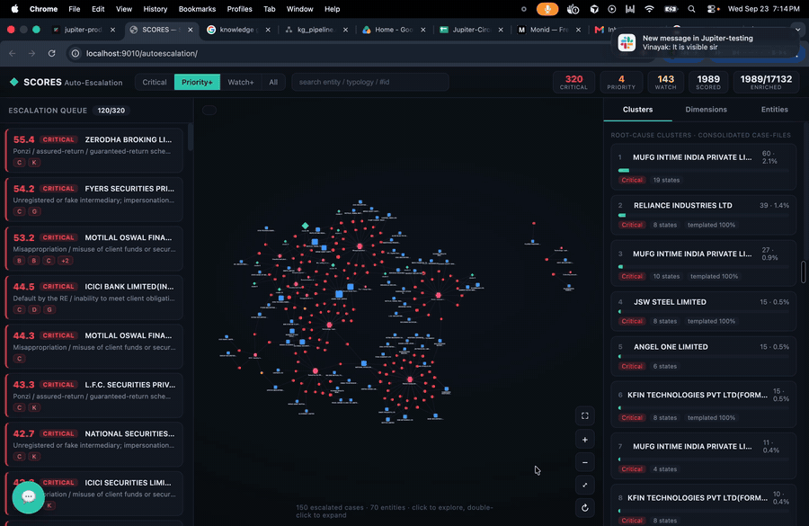

# project-kg

Knowledge-graph + Systemic-Criticality auto-escalation engine for SEBI SCORES,
implementing the **Systemic-Criticality Auto-Escalation Framework** (11
dimensions → Systemic-Criticality Score → tiered escalation).

**Fully self-contained.** It reads the existing `SEBI-project` MongoDB
collections **read-only** and never modifies any other service or collection.
The graph (Neo4j) is the store of record for the graph + computed scores. The
UI is served by this service at `/autoescalation` — the main `project-fe`
app is untouched.

## Demo

[](docs/media/kg-demo.mp4)

The escalation queue, the knowledge graph and the case detail panel at `/autoescalation`.
Click the preview to open the full video ([kg-demo.mp4](docs/media/kg-demo.mp4), 57 s, with audio).

## Architecture

```
MongoDB (read-only)              Neo4j (store of record)         This service
  tt_complaints      ──ETL──▶     (Complaint)-[…]->(Entity)  ──▶  /kg/* API + /autoescalation UI
  tr_complaints                   (Complaint)-[:ALLEGES]->(Typology)
  entity_master                   (Complaint)-[:MEMBER_OF]->(Cluster)
  *_master                        scores on nodes
```

## Ports

| Service | Port |
|---|---|
| KG API + UI | 9010 |
| Neo4j HTTP browser | 7474 |
| Neo4j Bolt | 7687 |

## Dev quickstart

```bash
# 1. bring up Neo4j
docker compose up -d neo4j

# 2. python env
python3 -m venv .venv && source .venv/bin/activate
pip install -r requirements.txt

# 3. build the graph from Mongo (structural ETL, no LLM)
python -m scripts.build_graph --wipe          # full
python -m scripts.build_graph --limit 500      # smoke test

# 4. run the API
uvicorn main:app --port 9010 --reload
curl localhost:9010/kg/health
```

Neo4j browser: http://localhost:7474 (user `neo4j`, pw from `.env`).

## Build phases

- **Phase 0** — scaffold + Neo4j ✅
- **Phase 1** — ontology + deterministic ETL (`scripts/build_graph.py`)
- **Phase 2** — LLM dimension enrichment (typology, amounts, vulnerability, distress, ATR-quality)
- **Phase 3** — semantic clustering (`SIMILAR_TO`, `Cluster`)
- **Phase 4** — SCS scoring engine (`config/defaults.py`)
- **Phase 5** — KG API (`/kg/*`)
- **Phase 6** — `/autoescalation` UI

## Notes

- **Dimension J (cross-portal correlation)** cannot be measured from this
  dataset (no MI-portal / examination data present); it is wired as a
  configurable stub scoring 0, not fabricated.
- All thresholds/weights live in `config/defaults.py` (SEBI-tunable; the tuning
  UI is a later phase).
